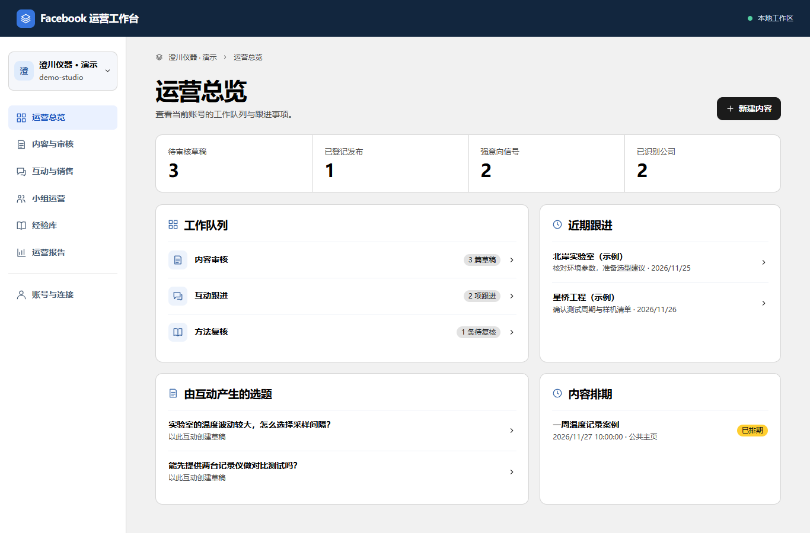

# Facebook 代运营与社交获客工作台

面向代运营团队和企业运营人员。以每家客户自己的产品、受众、发言身份和素材为起点，管理公共主页、个人主页、自管群组和第三方群组。内容能追到原始问题，销售能追到原始询盘，复盘能追到当时依据。

[下载 v1.0.0 技能包](https://github.com/chuntianxiaobaili-web/facebook-operations-workbench/releases/download/v1.0.0/Facebook-Operations-Workbench-v1.0.0.zip) · [Agent 接入教程](references/接口与验收.md) · [验收记录](references/测试记录.md) · [MIT 开源许可](LICENSE)



也可以拉取源码后直接体验虚构客户案例。

```sh
git clone https://github.com/chuntianxiaobaili-web/facebook-operations-workbench.git
cd facebook-operations-workbench
node demo.mjs
```

## 打开工作台

1. 解压整个包。Windows 双击 **Start-Facebook.cmd**，浏览器会打开本机工作台。macOS、Linux 或云电脑在包目录运行 `node run.mjs --open`。运行需要 Node.js 22.13 或更新版，界面已预编译。
2. 先体验时可以双击 **Start-Demo.cmd**，或运行 `node demo.mjs`。它会打开「栖光陈列」虚构客户，有三种渠道的稿件、两条入站问题和一条已审核的经验。每次演示使用新的临时数据目录。
3. 正式使用时，选一个长期一致的英文客户代号，填写业务档案。工作台地址默认为 http://127.0.0.1:4335。可用 `--data` 指定客户数据所在目录。升级程序时沿用该目录。
4. 在「知识」区域或 `state` 返回中取得本客户的 `vaultPath`，在 Obsidian 选择“打开文件夹作为仓库”。`node run.mjs doctor` 会查找已安装的 Obsidian，也会给出安装入口。Markdown 可以独立打开。

## 一次完整的代运营交付

| 阶段 | 操作 | 交付 |
|---|---|---|
| 接管 | 记录品牌、受众、主页编号、审批人、素材授权、群规和业务目标 | 客户档案与待核事项 |
| 选题 | 从评论、产品资料或真实异议选一个购买问题 | 主页答疑、个人经验稿、群内讨论稿，各有自己的切入点 |
| 执行 | 审稿、排期，按具体身份发布或交持有人操作；回读原帖 | 内容台账、时间和可追溯回执 |
| 识别需求 | 保存原话、来源和意向证据 | 问题选题、待核采购信号或已确认的入站询盘 |
| 销售交接 | 将确认询盘交给本客户的 B2B 智能销售工作台，读取与该消息相关的销售结果 | 销售消息回执、企业归属、报价或成交依据 |
| 复盘 | 查看周报，提交新的经验，按行业审核 | 客户交付报表及该客户独立的 Obsidian 笔记 |

## 三个场景分别怎样执行

**公共主页**支持有权限的 Page access token 预检、纯文字帖发布和回读、按原帖导入评论，以及针对已审目标评论的公开回复。已审核的纯文字主页帖子可本机定时派发。先绑定主页与当前 Graph 版本，把凭证设在本机环境，再执行 `meta-check`。到点派发须为所选客户显式启动下方服务并保持运行。离线错过时间的排期会在下次显式启动派发时检查，当天计划调整时先撤回排期。图片、视频和 Reels 可以做创意、素材说明与脚本，目前按原生发布流程交付。

```sh
node run.mjs --open --dispatch example
```

**个人主页**支持本人语气的选题、草稿、发布待办及事后回执。账号持有人在 Facebook 完成提交，再登记真实帖文编号与链接。**群组**支持选群、群规、入群问答草稿、管理员活动、自管群与第三方群的待办及原帖核验。加入群组、参与群聊或提交群贴，由相应身份在实际界面操作。Meta 对三个场景提供的接口不同。 [主页发布](https://developers.facebook.com/docs/graph-api/reference/page/feed/) · [个人分享](https://developers.facebook.com/documentation/sharing/reference/share-dialog) · [群组 API 更新](https://developers.facebook.com/documentation/development/graph-api/changelog/version19.0)

**Messenger** 可按页读取已授权公共主页的入站文字，或纳入用户提供的业务记录。每批会标注读取范围。运营人员读原话、确认询问性质、补企业和来源，再交接给销售工作台。公开与私下会话分开，可获报价或成交依据时再更新结果。

## 协议与框架

- **工作台界面**直接采用 Meta 开源的 Astryx 组件与 Neutral 主题。待审、排期和交接状态使用它的 Badge，按钮和页面底色使用主题变量。版本固定为 0.7.17，配合 React 和 StyleX。浏览器从本机读取已编译的界面。 [Meta Astryx](https://github.com/meta/astryx) · [前端说明与截图](frontend/README.md) · [第三方许可](THIRD-PARTY-NOTICES.md)
- **AI Agent** 通过 MCP 的 stdio 传输与工具交互，或直接用命令行调用。两种方式和图形界面共用 Node.js 业务逻辑及 SQLite 账本。 [接入与字段](references/接口与验收.md) · [MCP 规范](https://modelcontextprotocol.io/specification/2025-11-25/basic/transports)
- **Facebook** 通过带版本的 Graph API 与 Page access token 对接。Token 由当前企业授权后配置。**销售工作台**通过已实现的本机 HTTP 接口交换原始消息和回执。**Obsidian**使用按客户隔离的本地 Markdown 仓库。

## 可直接交给 Agent 的第一项工作

> 为一家面向商业空间设计师的材料供应商建一个独立的 Facebook 客户档案。根据我提供的产品说明和两条买家原话设计下周内容。公共主页交付一则带证据的答疑，个人主页交付一段待本人核实的观点稿，第三方群交付一条符合所附群规的评论。把确实要求索样的询问转交给我已绑定的销售工作台。最后生成交付周报，并提交一条有反例的 Obsidian 候选经验。

导出当前客户的 Markdown 周报可运行 `node run.mjs call example delivery-report --out 本周交付.md`。程序生成本机文件，由经办人核对后交付客户。程序接口、配置和真机验收步骤见 [接入手册](references/接口与验收.md)，本版实际验证结果见 [验收记录](references/测试记录.md)。

