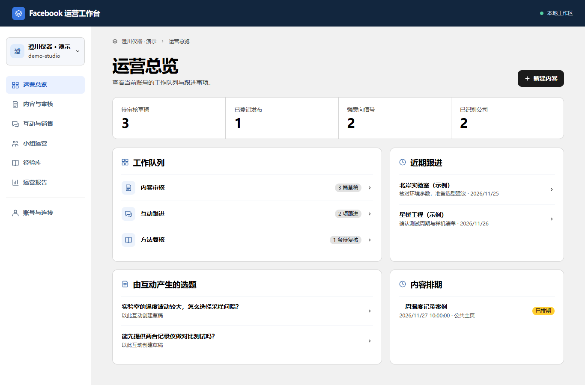

# 前端开发

运行工作台时，浏览器从本机服务加载 `public/` 内的成品。前端采用 React 与 React DOM，按钮等公共控件使用 StyleX 编译为静态 CSS。导航及响应式布局见 `layout.css`。原始组件在当前目录，构建不依赖 CDN。

修改后在本目录运行以下命令，使用 Node.js 22 或更新版本及 npm。

```sh
npm ci
npm run build
```

构建后从工作台根目录按主 README 启动。浏览器通过同源 `GET /api/{tenant}/state` 读取账号快照，通过 `POST /api/{tenant}/{action}` 写入当前账号。发布凭据登记是对既有操作的本地记账。浏览器没有 Meta 发布按钮。

## 设计系统与预览

工作队列数量与内容、销售、知识复核状态均使用 Meta Astryx 的官方 `Badge` 组件。构建脚本合并 Core 的基础样式和 Neutral 主题，通过页面根元素的 `data-astryx-theme="neutral"` 激活主题。按钮的文字、填充、边框和圆角，以及工作区底色取自同一主题。两个 Astryx 包均锁定于 0.7.17，采用 MIT 许可证。



参考 [Astryx](https://github.com/meta/astryx)、[React](https://react.dev/) 和 [StyleX](https://stylexjs.com/docs/learn/installation/)。

